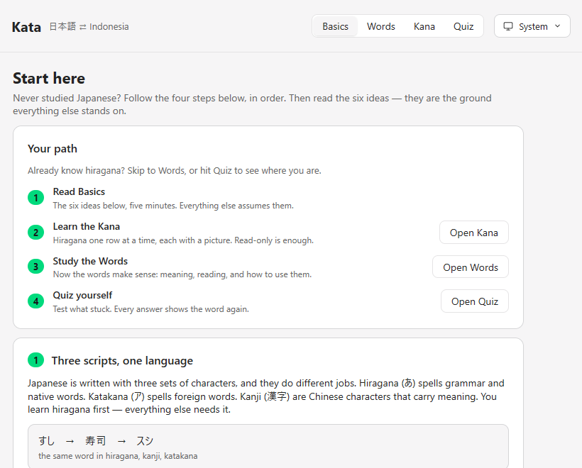
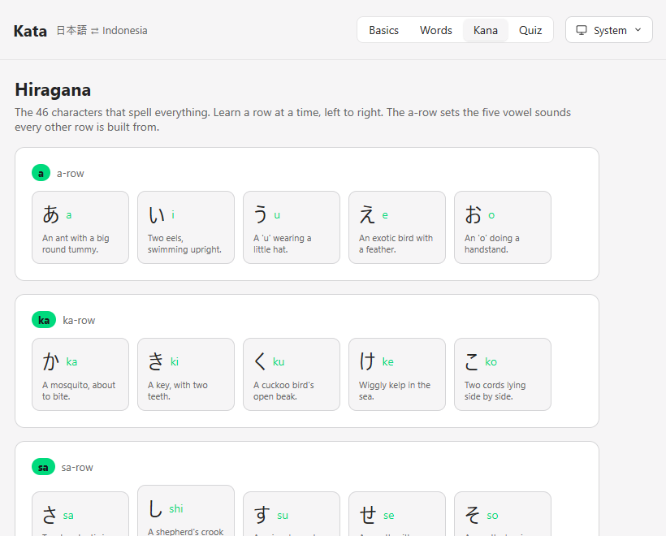
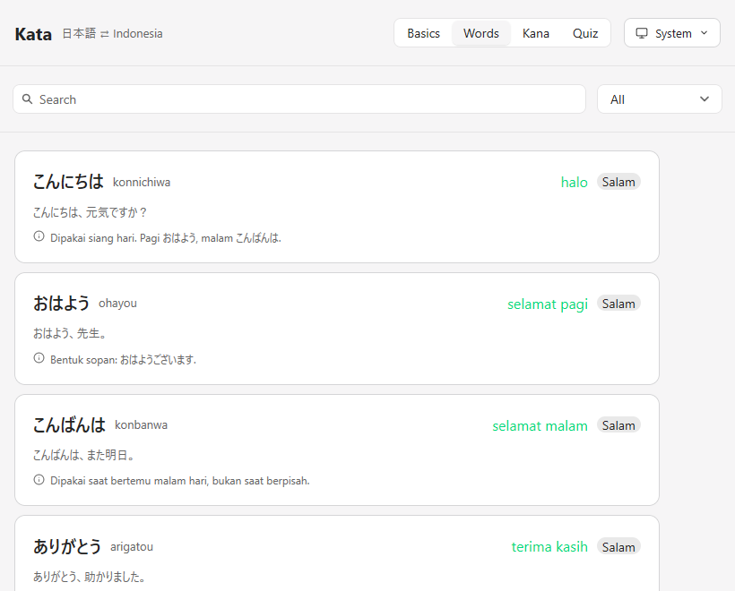
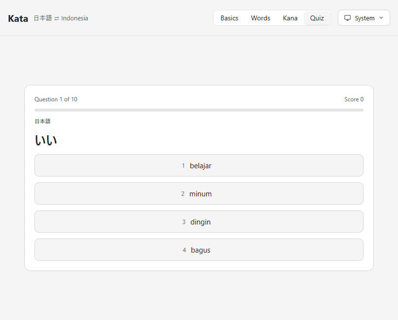

# Kata

A small native app to learn **Japanese → Indonesian**, built for someone who
has never read a single kana. It teaches the ideas first, then the words,
then the characters, then tests you.

Built with [MyGo](https://github.com/egoist/mygo) — pure Go, no cgo, no
webview. It shares the [ports](https://github.com/yaffalhakim1/ports) brand,
so the two apps look like one family.



## Where to start

Never studied Japanese? Do not open Words first — the kanji will just look
like noise. Go in this order:

1. **Read Basics.** Six short cards, five minutes. They explain the three
   scripts, why there is no word for "is", and how particles work. Everything
   else assumes these.
2. **Learn the Kana.** The Kana page teaches hiragana one row at a time with a
   picture for each. Do the a-row first, then one more row a day. You only
   need to *read* them, not write them — that is enough to start.
3. **Study the Words.** Now the words make sense: each shows the Japanese, its
   reading, the meaning, and a note on how to actually use it.
4. **Quiz yourself.** Pick Words or Kana, answer four choices, and every answer
   shows the word again so you learn from mistakes.

Already know hiragana? Skip straight to **Words**, or hit **Quiz** to test
where you are. Your topic and search carry into the quiz, so you can drill one
topic at a time.

## How it teaches

Competitors like Tofugu teach kana first with mnemonics; Tae Kim's guide
teaches grammar by concept before vocabulary. Kata does both:

- **Basics** — the six ideas that make everything else click: the three
  scripts, that there is no word for "is", politeness, particles, why the
  verb comes last, and long vowels. This is the first page on purpose.
- **Words** — 48 common words, each with the Japanese, its romaji, the
  Indonesian meaning, an example sentence, **and a note on how the word is
  actually used** (which particle, which politeness, what it does not mean).
  Search and filter by topic.
- **Kana** — all 46 hiragana, row by row in teaching order, each with a
  picture mnemonic ("か is a mosquito", "ぬ is smooth bendy noodles"). The
  a-row comes first because every other row is built from those five vowels.
- **Quiz** — over words or kana. Pick the direction and length, answer four
  choices, and every answer reveals the word or character with its reading
  and mnemonic, so a wrong answer teaches rather than only scoring.

## Screenshots

| Basics | Kana |
|---|---|
|  |  |

| Words | Quiz |
|---|---|
|  |  |

## Install

Download the installer from [Releases](../../releases) and run it. It
installs per user to `%LOCALAPPDATA%\Programs\Kata`, with no administrator
prompt. Uninstall from Settings, Apps.

## Build

Needs [Go](https://go.dev/dl/) 1.27 or later. No other toolchain.

```sh
go tool mygo build      # Kata.exe and the installer, in build/windows-amd64
go tool mygo dev        # run with live reload
go test ./...           # the tests
go tool mygo vet .      # MyGo lifetime checks
```

The render tests write PNGs of the window into `testdata/`, so a change to
the interface can be looked at without launching the app.

## Layout

```
main.go            startup and the window
app.go             the window's state and the pages
concepts.go        the Basics lessons
deck.go            the word list and its filters
kana.go            the hiragana table with mnemonics
model.go           the quiz engine, and the word/kana questions
view_common.go     the header and shared pieces
view_basics.go     the Basics page
view_study.go      the Words page
view_kana.go       the Kana page
view_quiz.go       the Quiz page
palette.go theme.go the brand colour system
appearance.go      System / Light / Dark
settings.go        the remembered settings
icons.go           the icons
```

## Licence

MIT
