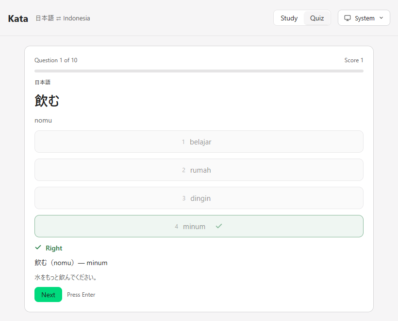

# Kata

A small native app to learn **Japanese → Indonesian** vocabulary: browse the
words, then quiz yourself on them.

Built with [MyGo](https://github.com/egoist/mygo) — pure Go, no cgo, no
webview. It shares the [ports](https://github.com/yaffalhakim1/ports) brand,
so the two apps look like one family.


## What it does

- **Study** — the words as cards: the Japanese, its romaji reading, the
  Indonesian meaning, and a short example sentence. Search by any of them,
  or filter by topic.
- **Quiz** — pick the direction (日本語 → Indonesia or the reverse), how many
  questions, and go. Four choices per question, with the right answer and a
  wrong pick both marked by an icon as well as a colour. Answer with the
  mouse or the keys `1`–`4`, move on with `Enter`.
- **Results** — the score and a verdict, then shuffle and try again.
- **Appearance** — System, Light or Dark, from a one-click menu on the
  button. The choice is remembered between runs.
- The topic and search carry from Study into the quiz, so you can drill one
  topic.

## Screenshots

| Study | Quiz |
|---|---|
|  |  |

A wrong or right answer is shown with an icon and the word's example:



## Install

Download the installer from [Releases](../../releases) and run it. It
installs per user to `%LOCALAPPDATA%\Programs\Kata`, with no administrator
prompt. Uninstall from Settings, Apps.

## Build

Needs [Go](https://go.dev/dl/) 1.27 or later. No other toolchain.

```sh
go tool mygo build      # Kata.exe and the installer, in build/windows-amd64
go tool mygo dev        # run with live reload
go test ./...           # the tests
go tool mygo vet .      # MyGo lifetime checks
```

The render tests write PNGs of the window into `testdata/`, so a change to
the interface can be looked at without launching the app.

## Layout

```
main.go            startup and the window
app.go             the window's state and the two pages
deck.go            the word list and its filters
model.go           the quiz: questions, choices, scoring
view_common.go     the header and shared pieces
view_study.go      the Study page
view_quiz.go       the Quiz page
palette.go theme.go the brand colour system
appearance.go      System / Light / Dark
settings.go        the remembered settings
icons.go           the icons
```

## Licence

MIT
